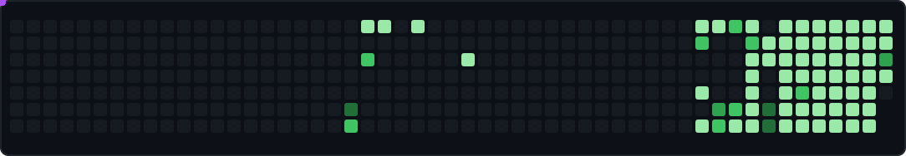

  

<h1 align="center">Hi 👋, I'm Rahul</h1>
<h3 align="center">Java Full Stack Developer crafting scalable backend systems</h3>

---

### 👨‍💻 About Me

- 💻 Java Full Stack Developer with strong backend expertise
- 🎓 B.Sc Computer Science graduate with solid programming fundamentals
- 🚀 Experienced in building scalable and real-world web applications
- ⚙️ Skilled in Core Java, Jakarta EE, Spring Boot, REST APIs & Microservices
- 🌐 Proficient in React.js, HTML, CSS, and JavaScript
- 🗄️ Hands-on experience with Oracle & MySQL databases
- 🤖 Exploring AI tools and modern software development practices
- 🎯 Focused on writing clean, efficient, and maintainable code

---

### 🛠️ Tech Stack

**Languages & Frontend**

**Backend & APIs**

**Databases**

**Tools & Platforms**

---

### 📊 GitHub Stats

  

  

  

---

### 🐍 Contribution Snake

  

  🐍 Custom empty-cell contribution snake by <b>Rahul Sahane</b> — feel free to copy and customize it. Please keep the credit.

1. Copy <code>scripts/empty_snake.py</code>.
2. Copy <code>.github/workflows/empty-snake.yml</code>.
3. Create the <code>dist</code> folder and let GitHub Actions generate <code>empty-snake.svg</code>.
4. Update your README to display <code>./dist/empty-snake.svg</code>.
5. Keep the credit to <b>Rahul Sahane</b> when you reuse or modify this project.

🌐 Connect with Me

  
  

  

